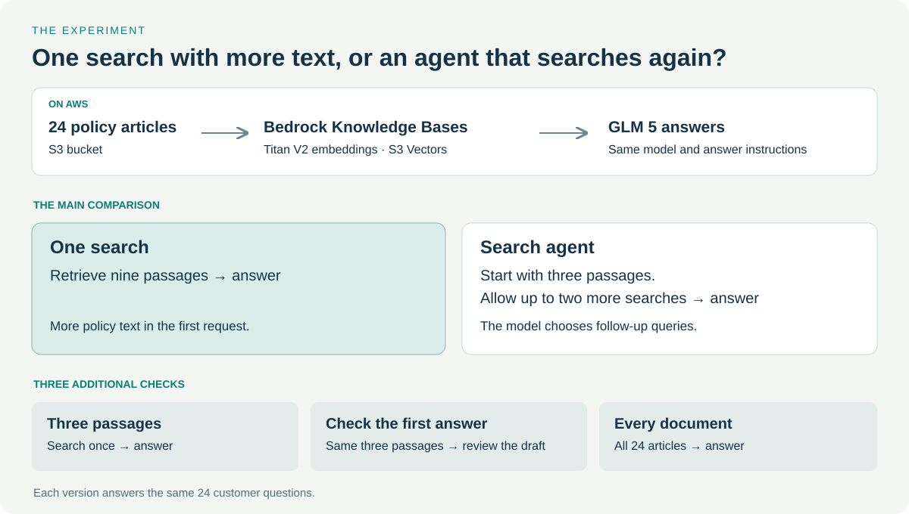

# Bedrock RAG Lab

Does a support chatbot benefit from searching again? This lab compares one search
with nine passages against an agent allowed two follow-up searches, using Amazon
Bedrock and a fictional outdoor store's policies.

**[Compare the answers](https://www.marcelops.com/bedrock-rag-lab/explorer/)**

## Results

Every version answers the same 24 questions using GLM 5. A passing answer must
apply the correct policies, calculate amounts correctly, support its claims,
and identify missing information. Scores come from AI-assisted review against
the [evaluation method](docs/method.md).

| Version | Passed | Median API time | Estimated model cost / 24 answers |
|---|---:|---:|---:|
| One search, nine passages | 22/24 | 2.58 s | $0.0540 |
| Search agent | 20/24 | 4.42 s | $0.0662 |
| Three passages | 21/24 | 2.45 s | $0.0278 |
| Check the first answer | 21/24 | 5.14 s | $0.0590 |
| Every document | 22/24 | 2.54 s | $0.1577 |

The nine-passage search produced more passing answers than the agent at lower
model cost and with less API time. Some failures occurred even when the model
received the right policy. The viewer lets you inspect those answers and their
source passages.

API time includes retrieval and generation. Costs use reported tokens at $1 per
million input tokens and $3.20 per million output tokens. Storage, embeddings,
and vector operations are separate. The three-passage answer is the first draft
of the two-call checking version, so those rows share a call. The evaluation used
141 model calls and $0.3369712 in estimated model cost.

## Explore locally

Clone the repository and serve the files with Python 3.10 or later:

```sh
git clone https://github.com/marceloacosta/bedrock-rag-lab.git
cd bedrock-rag-lab
python3 -m http.server 8000
```

Open <http://localhost:8000/explorer/>. You can also open `explorer/index.html`
directly in a browser. Viewing the recorded answers needs no AWS account.

## Verify the results

These commands run locally without calling AWS:

```sh
python3 tools/run_experiment.py validate
python3 tools/verify_results.py
python3 -m unittest discover -s tests
```

The verifier checks all 96 execution records, 120 scored answers, source hashes,
token costs, timings, and shared-call accounting. The tests check run isolation,
report output protection, citation validation, and cleanup handling.

## Run your own comparison

Follow [Run the experiment](docs/run.md) to configure an isolated AWS profile,
create the knowledge base, run the questions, review the answers, and remove the
resources. New runs write to separate directories.

The stack uses 24 policy documents in S3, Bedrock Knowledge Bases, Titan Text
Embeddings V2, S3 Vectors, and GLM 5. The agent's search loop is implemented in
Python with Bedrock's `Retrieve` and `Converse` APIs.



## Repository contents

| Path | Contents |
|---|---|
| `data/` | Fictional store policies and customer questions |
| `experiment.py` | Retrieval, model calls, and bounded search loop |
| `measurements/recorded/` | Requests, responses, judgments, and measured results |
| `explorer/` | Answer comparison viewer |
| `tools/` | Run, report, verification, and privacy commands |
| `docs/` | Setup, evaluation method, and production guidance |

See [Evaluation and production](docs/evaluation.md) for managed evaluation,
customer-data checks, monitoring, and release testing.
